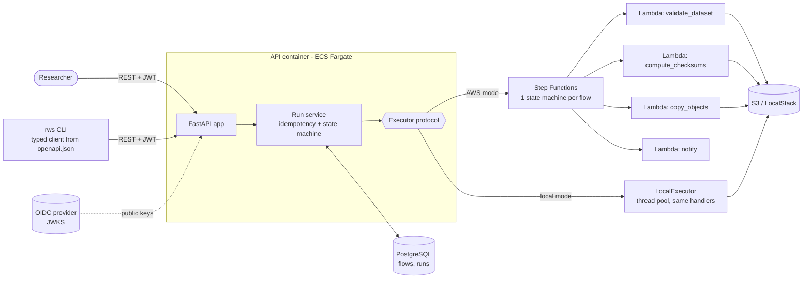
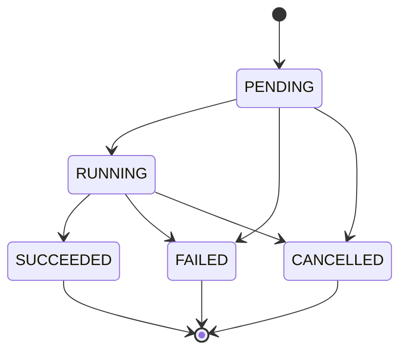

# Research Workflow Service

[](https://github.com/rodrigotmuniz/research-workflow-service/actions/workflows/ci.yml)

A small backend for **data automation flows** on research datasets. A researcher defines
a flow once (for example *validate a dataset in S3 → compute checksums → copy to an
archive bucket → notify*), starts runs with different inputs, and tracks each run's
status through a REST API or a CLI.

Runs are **asynchronous** (the API answers `202 Accepted` at once), **safe to retry**
(idempotency keys, idempotent tasks), **secure** (OAuth2/OIDC bearer tokens, scopes,
per-user ownership) and **observable** (structured JSON logs with request and run ids,
health probes, a persisted run state machine).

## Architecture



Run lifecycle (enforced with compare-and-set updates in `src/rws/runs.py`):



### Code map

| Path | What it does |
|---|---|
| `src/rws/flows.py` | Flow definition language (Pydantic v2 discriminated union of typed steps) |
| `src/rws/asl.py` | Compiles a flow into Amazon States Language |
| `src/rws/tasks/` | Task handlers (boto3/S3), error types, retry with backoff. Deployable as Lambdas |
| `src/rws/executors/` | `Executor` protocol, `LocalExecutor`, `StepFunctionsExecutor` |
| `src/rws/runs.py` | Run lifecycle: idempotent start, cancel, state transitions, status refresh |
| `src/rws/auth.py` | JWT validation (RS256 + JWKS), scopes, local dev issuer |
| `src/rws/api/` | FastAPI app factory, routes, dependencies, schemas |
| `src/rws/client/`, `src/rws/cli.py` | Typed client generated from `openapi.json`, and the `rws` CLI |
| `migrations/` | Alembic migrations (PostgreSQL in Docker, SQLite in quick tests) |
| `infra/` | SAM/CloudFormation template (S3, Lambda, Step Functions, IAM, ECS) and compiled ASL |
| `docs/adr/` | Architecture decision records |

## Run it locally (no AWS account needed)

Requires Docker and [uv](https://docs.astral.sh/uv/).

```bash
docker compose up -d --build --wait   # API + PostgreSQL + LocalStack (S3, with a demo dataset)
./scripts/smoke.sh                    # create a flow, start a run, wait for SUCCEEDED
docker compose down -v
```

The API is on http://localhost:8000 (interactive docs at `/docs`). For development:

```bash
uv sync                 # Python 3.12 + dependencies
make lint test          # ruff, mypy, cfn-lint, pytest with coverage
```

## API examples

```bash
API=http://localhost:8000
# Dev tokens exist only when the API runs with RWS_AUTH_MODE=dev (docker compose sets it).
TOKEN=$(curl -s -X POST $API/dev/token -H 'Content-Type: application/json' \
  -d '{"subject": "alice"}' | python3 -c 'import json,sys; print(json.load(sys.stdin)["access_token"])')

# Create a flow (scope flows:write)
curl -s -X POST $API/flows -H "Authorization: Bearer $TOKEN" -H 'Content-Type: application/json' \
  --data @examples/archive-dataset.flow.json

# Start a run (scope runs:start). Repeating this request with the same key returns the same run.
curl -s -X POST $API/flows/$FLOW_ID/runs -H "Authorization: Bearer $TOKEN" \
  -H 'Content-Type: application/json' -H 'Idempotency-Key: archive-2026-10-31' \
  -d '{"input": {"bucket": "rws-data", "prefix": "datasets/demo/",
                 "archive_bucket": "rws-archive", "archive_prefix": "archive/demo"}}'

# Track it (scope flows:read)
curl -s $API/runs/$RUN_ID -H "Authorization: Bearer $TOKEN"
curl -s "$API/runs?status=FAILED&limit=20" -H "Authorization: Bearer $TOKEN"   # cursor-paginated
curl -s -X POST $API/runs/$RUN_ID/cancel -H "Authorization: Bearer $TOKEN"
```

The same with the CLI:

```bash
export RWS_API_URL=http://localhost:8000
export RWS_TOKEN=$(uv run rws login --subject alice)
uv run rws flows create examples/archive-dataset.flow.json
uv run rws runs start $FLOW_ID --input "$(cat examples/archive-dataset.input.json)" --wait
uv run rws runs list --status SUCCEEDED
```

### Flow definitions

A flow is an ordered list of steps. String params starting with `$.` reference the run
document (`$.input.*` for run input, `$.results.<step_id>.*` for earlier step outputs),
with the same meaning in both executors because they map 1:1 to ASL `"key.$"` paths.

```json
{"id": "archive", "action": "copy_objects",
 "params": {"source_bucket": "$.input.bucket", "source_prefix": "$.input.prefix",
            "dest_bucket": "$.input.archive_bucket", "dest_prefix": "$.input.archive_prefix"},
 "retry": {"max_attempts": 5, "interval_seconds": 2, "backoff_rate": 2.0, "max_delay_seconds": 60}}
```

Actions: `validate_dataset`, `compute_checksums`, `copy_objects`, `notify`. Definitions are
validated when the flow is created, so a run never starts with a malformed flow.

## Design decisions and trade-offs

Longer write-ups are in [`docs/adr/`](docs/adr).

- **Step Functions for orchestration** ([ADR 1](docs/adr/0001-step-functions-orchestration.md)).
  Durable state, retries with backoff, timeouts and an execution history come from a
  managed service instead of our own scheduler. Each flow compiles to its own state
  machine (created lazily, once, since flows are immutable); each run is one execution
  named after the run id. Trade-offs: AWS lock-in and per-transition cost; Temporal or
  Airflow would be the portable alternatives.
- **Executor protocol + local mode** ([ADR 2](docs/adr/0002-executor-protocol-and-local-mode.md)).
  The API depends on `Executor` (`start` / `cancel` / `describe`). `LocalExecutor` runs
  the *same* task handlers, run document and retry policy in a thread pool, so the full
  system runs with `docker compose` and tests need no AWS. LocalStack is used for S3
  only; running Step Functions + Lambda in LocalStack needs Docker-in-Docker and adds
  little over testing the ASL compiler and the executor against moto.
- **At-least-once execution, idempotent tasks** ([ADR 3](docs/adr/0003-idempotency-and-at-least-once.md)).
  Step Functions retries and client retries mean a task can run twice. Tasks are written
  so that is harmless: the checksum manifest is deterministic, copies skip objects that
  already match (size + ETag), webhooks carry an `Idempotency-Key` header. Starting a run
  accepts an `Idempotency-Key`: same key + same body returns the original run (`200`),
  same key + different body is `409`. If the executor is down, the run stays `PENDING`,
  the API answers `503 Retry-After`, and a retry with the same key launches it.
- **Errors are classified.** `TransientError` (throttling, 5xx, network) is retried with
  exponential backoff, capped at `max_delay_seconds`, with full jitter: ASL `Retry` blocks
  get `BackoffRate`, `MaxDelaySeconds` and `"JitterStrategy": "FULL"`, and the local
  executor computes the same delays in `src/rws/tasks/retry.py`. `TaskError` (bad input,
  missing bucket, failed validation) fails the run immediately with a readable `error`.
- **Status writes are compare-and-set.** `UPDATE ... WHERE status IN (allowed sources)`
  means a user cancelling and a worker finishing at the same moment cannot both win.
- **Auth model** ([ADR 4](docs/adr/0004-auth-model.md)). Resource server only: RS256 JWTs
  verified against the provider's JWKS, with issuer, audience and expiry checks; scopes
  per endpoint (`flows:read`, `flows:write`, `runs:start`); every query is filtered by
  the token subject, and other users' resources return `404`, not `403`. The default
  auth mode is `jwks` (external OIDC provider); without `RWS_AUTH_JWKS_URL` the API
  refuses to start. Dev mode (`RWS_AUTH_MODE=dev`, set by docker compose and `make run`)
  generates an in-memory key pair and mounts `POST /dev/token`, which mints a token for
  any subject: it is for local use only, and the API refuses to start with it when
  `RWS_ENV=production`. No keys are stored in the repo.
- **Keyset pagination** on `(created_at, id)` with an opaque cursor: stable while new runs
  are inserted, and served by a composite index.
- **Published contract.** `openapi.json` is generated from the app and committed; CI fails
  if it drifts. The CLI's typed models are generated *from* that file, so the repo is both
  a producer and a consumer of its OpenAPI schema.

## What I would do next

- Push status updates instead of polling Step Functions on read: an EventBridge rule on
  execution status changes → a small Lambda that applies the same `transition()`.
- A reconciler for runs left `PENDING` without an idempotent retry from the client.
- Per-step progress in the database (a `run_steps` table) and an execution-history endpoint.
- Flow sharing and group-based roles on top of the ownership model.
- Large objects: multipart checksums and copy verification with S3 additional checksums
  instead of ETags.
- Deployment pipeline (SAM deploy from CI with OIDC role assumption), alarms on failed
  executions and API 5xx, and an ALB in front of the ECS service.
- An SDK/CLI package published separately from the service.
